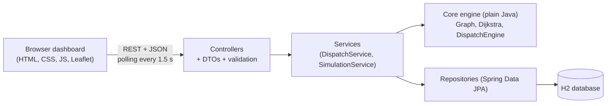
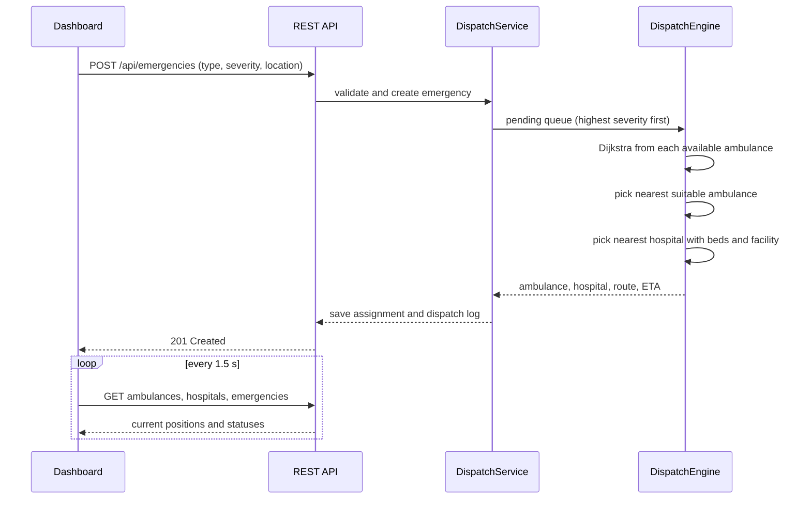

# LifeGrid: Smart Ambulance Dispatch and Hospital Routing

LifeGrid is a Java and Spring Boot simulation that decides, for every reported emergency, **which emergency is handled first, which ambulance goes, and which hospital receives the patient**. A web dashboard shows the city map, live ambulance movement, hospital bed capacity, a dispatch log and reports.

> **Disclaimer:** LifeGrid is a college project. All data is simulated and every travel time is an estimate. It is **not** real emergency dispatch guidance.

## Features

- **Emergency prioritization:** a priority queue orders emergencies by severity (10 is most critical), then by earliest report time.
- **Shortest-route ambulance selection:** Dijkstra's algorithm on a road network of 18 intersections and 24 roads. The nearest suitable available ambulance is chosen, and critical cases (severity 8 and above) need an ADVANCED ambulance.
- **Hospital selection with fallback:** the nearest hospital with free beds and the required facility. If it is full, the next best one is used.
- **Live simulation:** ambulances move node by node along their routes (accelerated time), change status, and are freed when the trip ends. Waiting emergencies are dispatched automatically when an ambulance becomes free.
- **Persistence:** emergencies, assignments and dispatch logs are stored in an H2 database.
- **Dashboard:** Leaflet map, emergency form, quick scenarios, ambulance and hospital cards, dispatch log, reports with chart, CSV export.
- **REST API** with validation, consistent error responses and Swagger documentation.

## Tech stack

| Layer | Technology |
|---|---|
| Language | Java 17 |
| Backend | Spring Boot 3, Spring Web, Spring Data JPA, Bean Validation |
| Database | H2 (file mode, created and seeded automatically) |
| Build | Maven (Maven Wrapper included) |
| Frontend | HTML, CSS, vanilla JavaScript (ES modules), Leaflet, Chart.js |
| API docs | springdoc-openapi (Swagger UI) |
| Tests | JUnit 5, Spring Boot Test, MockMvc |

## Architecture



The algorithms (`core` package) have no Spring dependency, so they can be unit tested on their own. The services load data from the database, call the engine, and save the results.

## How a dispatch works



Ambulance status flow: `AVAILABLE` -> `DISPATCHED` -> `AT_SCENE` -> `TO_HOSPITAL` -> `AVAILABLE`.

## Algorithms

**Dijkstra's shortest path.** The city is a weighted graph (intersections are nodes, roads are weighted edges). A `PriorityQueue` always expands the closest unvisited node, a distance array holds the best known distance to each node, and a previous-node array rebuilds the path. Complexity is O((V + E) log V). Travel time is estimated as distance divided by an average speed of 40 km/h, with an optional traffic multiplier.

**Emergency prioritization.** Pending emergencies are kept in a `PriorityQueue` ordered by severity (descending), then report time (ascending), so the most critical and oldest case is always dispatched first.

**Allocation rules.** The ambulance with the smallest travel time is chosen. Severity 8 and above requires an ADVANCED ambulance. The hospital must have at least one free bed and the required facility (for example CARDIAC or TRAUMA). If none qualifies, a clear exception is raised (`NoAmbulanceAvailableException` or `HospitalFullException`) and the emergency stays pending.

## Project structure

```
src/main/java/com/lifegrid/
  config/       data seeder, OpenAPI and CORS configuration
  controller/   REST controllers
  core/         Graph, Dijkstra router, DispatchEngine, exceptions (no Spring)
  domain/       JPA entities
  dto/          request and response objects
  repository/   Spring Data repositories
  service/      DispatchService, SimulationService
src/main/resources/static/
  index.html
  css/styles.css
  js/           api.js, map.js, app.js
src/test/java/  unit and integration tests
```

## Getting started

Requirements: **Java 17 or higher** (check with `java -version`). Maven is not required because the wrapper is included.

```bash
git clone <your-repository-url>
cd <project-folder>
./mvnw spring-boot:run
```

On Windows use `mvnw.cmd spring-boot:run`.

Then open:

- Dashboard: http://localhost:8080
- API documentation: http://localhost:8080/swagger-ui.html

The database is created and seeded on the first run (18 intersections around Vijayawada, 5 ambulances, 4 hospitals). The dashboard map needs an internet connection for the street tiles.

Run the tests:

```bash
./mvnw test
```

## API overview

| Method | Endpoint | Description |
|---|---|---|
| GET | `/api/nodes` | Road network intersections |
| GET | `/api/roads` | Roads and distances |
| GET | `/api/ambulances` | Ambulances with status, position and progress |
| GET | `/api/hospitals` | Hospitals with bed availability and facilities |
| GET | `/api/emergencies` | All emergencies |
| GET | `/api/emergencies/{id}` | One emergency |
| POST | `/api/emergencies` | Report an emergency and trigger dispatch |
| GET | `/api/dispatches` | Dispatch log |
| GET | `/api/reports/summary` | Summary figures |
| POST | `/api/simulation/reset` | Reset the simulation to its starting data |

Example request:

```bash
curl -X POST http://localhost:8080/api/emergencies \
  -H "Content-Type: application/json" \
  -d '{"type":"CARDIAC","severity":9,"locationNodeId":<node-id-from-/api/nodes>}'
```

Node ids change when the simulation is reset, so read them from `GET /api/nodes` first.

## Using the dashboard

1. Click **Reset simulation** for a clean start.
2. Choose a type, severity and location (or click an intersection on the map) and press **Dispatch ambulance**, or use a **Quick scenario**.
3. Watch the ambulance move on the map and its status change in the right panel.
4. Open the **Reports** tab for figures and **Export CSV** to download the dispatch log.

## Limitations

- All data and travel times are simulated.
- The road network is small and fixed, and routes are drawn as straight segments between intersections.
- No authentication.
- Map tiles are loaded from the internet.

## Future work

- Real GPS and live traffic data
- Speech-to-text intake of emergency calls
- MySQL or PostgreSQL instead of H2
- Authentication and roles
- Multiple cities and larger road networks

